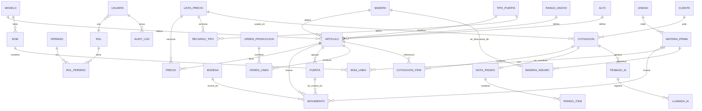

# DATA-MODEL.md — Modelo de datos

PostgreSQL (ADR-0005). Ids `uuid`; fechas `timestamptz` en UTC, mostradas en America/Santiago. Importes en **CLP enteros** (`bigint`). Costos y precios de lista importados del Excel: `numeric(14,4)` (no son importes cotizados). Toda tabla mutable tiene `creado_en`, `creado_por` y `actualizado_en`.

## 1. Diagrama ER

## 2. Tablas

### Usuarios y seguridad (REQ-ADM)
| Tabla | Columnas clave | Reglas |
|---|---|---|
| `permiso` | `codigo` PK (p. ej. `stock.mover`), `descripcion` | Sembrada; lista en SECURITY §1 |
| `rol`, `rol_permiso` | `rol.nombre` único; (`rol_id`, `permiso_codigo`) | Hoy: `administrador` con todos |
| `usuario` | `email` único, `nombre`, `hash_password` (argon2id), `rol_id`, `activo` | No se borra, se desactiva; siempre queda ≥ 1 activo con `usuarios.gestionar` (REQ-ADM-2.4) |
| `sesion` | `token_hash`, `usuario_id`, `expira_en`, `ip` | 8 h |
| `intento_login` | `email`, `ip`, `ocurrido_en`, `ok` | Limitación de intentos |
| `audit_log` | Ver SECURITY §3 | Solo INSERT (trigger) |
| `idempotencia` | `clave` + `usuario_id` PK, `hash_cuerpo`, `respuesta` jsonb, `expira_en` | 24 h |

### Catálogo (REQ-STK-1)
| Tabla | Columnas clave | Reglas |
|---|---|---|
| `modelo` | `nombre` (NELTUME), `codigo` (NEL), `familia` (`puerta`/`accesorio`), `fuera_catalogo`, `activo` | 33 puertas + 5 accesorios; los modelos creados por la carga de inventario (MAMPARA LICAN…) van `fuera_catalogo` (ADR-0018) |
| `alias_modelo` | `alias` PK (normalizado), `modelo` (nombre), `tipo` (`seguro`/`posible`) | Semilla con los alias reales de la tienda; editable con `catalogo.editar` (REQ-COT-2.11) |
| `madera` | `nombre` normalizado (PINO OREGON, LENGA, MARA, RAULI), `codigo` (O/L/M/R), `fuera_catalogo` | La comparación ignora tildes; las de inventario que no están en la lista (PINO BLANCO, ALAMO, MDF…) van `fuera_catalogo` |
| `rango_ancho` | `codigo` (1–9), `etiqueta` ("0,80 A 0,85"), `min_m`, `max_m` | Para accesorios: `2x4`…, `6X1`… como texto |
| `alto` | `codigo` (A–G para 2,0–2,6; H… en accesorios), `alto_m` | |
| `tipo_puerta` | `nombre` (BLOQUE, PANEL, ESPECIAL) | |
| `articulo` | `codigo` único (`NEL-R-4-B`), `modelo_id`, `madera_id`, `ancho_codigo` (1–9 en puertas; `2X4`, `6X1`… en accesorios), `ancho_etiqueta`, `alto_codigo`, `alto_m` (alto o largo), `espesor`, `pulgadas`, `tipo_puerta_id` null, `stock_minimo` null, `fuera_catalogo`, `activo` | Único por (modelo, madera, ancho_codigo, alto_codigo). `rango_ancho` y `alto` quedan como referencia de puertas para el mapeo exacto. Fuera de catálogo: ancho y alto en mm (`MOL-O-780X2066`), sin precio; el cotizador y la IA no los ven (REQ-STK-8.7) |
| `bodega` | `nombre` ("Fábrica"), `zona` | Una sola en v1 (supuesto S1) |
| `feriado` | `fecha` PK, `nombre` | Solo feriados **adicionales** (elecciones, leyes puntuales); los legales se calculan en `src/domain/precios/feriados.ts` (REQ-COT-6.6) |
| `parametro` | `clave`, `valor` jsonb | `vigencia_dias_habiles`=10, `iva`=0.19, `abono_pct`=50 (ADR-0020), `chipax_intervalo_min`=30 y `chipax_ventana_dias`=45 (ADR-0021), topes de IA |

### Precios versionados (REQ-COT-1)
| Tabla | Columnas clave | Reglas |
|---|---|---|
| `lista_precio` | `version` (serial), `origen` (`excel`/`edicion`), `archivo_hash`, `vigente_desde`, `creado_por`, `vigente` bool | Solo una `vigente`; las antiguas son inmutables |
| `precio` | `lista_id`, `articulo_id`, `costo_produccion`, `costo_materiales`, `costo_insumos`, `costos_generales`, `costo_total`, `margen`, `precio_neto` | PK (`lista_id`, `articulo_id`); costos visibles solo con `costos.ver`; **solo inserción** (trigger) |
| `recargo_tipo` | `lista_id`, `tipo_puerta_id` (null = accesorios), `porcentaje` | Sembrado en 0 % (DESIGN C2) |
| `importacion` | `archivo_hash`, `nombre_archivo`, `lista_id` null, `creadas`, `actualizadas`, `sin_cambios`, `rechazadas`, `rechazos` jsonb `[{fila, motivo}]`, `correcciones` jsonb `[{fila, detalle}]` | Sin valores de costo ni precio; `GET /importaciones/:id` |

Una edición en pantalla copia la versión vigente, aplica el cambio y crea `version + 1` (REQ-COT-1.1).

### Inventario y producción (REQ-STK, REQ-MP)
| Tabla | Columnas clave | Reglas |
|---|---|---|
| `unidad` | `codigo` (un, m, m2, m3, pulg, kg, lt), `nombre` | |
| `materia_prima` | `nombre` único, `unidad_codigo`, `stock_minimo` null, `activo` | |
| `movimiento` | `ocurrido_en`, `bodega_id`, `articulo_id` XOR `materia_prima_id`, `puerta_id` null, `tipo`, `cantidad` numeric (con signo), `motivo`, `ref_tipo` + `ref_id` (orden, pedido, recepción, manual, puerta), `idempotencia_clave`, `usuario_id` | **Inmutable**: un trigger rechaza UPDATE y DELETE; el rol de la app no tiene esos grants. Toda entrada, salida o ajuste de un artículo de puertas lleva `puerta_id` y vale ±1; los accesorios siguen por cantidad (ADR-0018) |
| `puerta` | `codigo` único (etiqueta), `articulo_id`, `ancho_mm`, `alto_mm`, `ubicacion`, `calidad` (`primera`/`segunda`), `observacion`, `fecha_produccion` null, `origen` (`inventario_inicial`/`produccion`/`manual`/`conversion`) | Existencia y apartado salen de sus movimientos (vista `v_puerta`): 0 o 1 cada uno, nunca apartada sin existencia (*constraint trigger*). Ubicación, calidad y observación se editan con auditoría; `articulo_id` no cambia. Códigos nuevos: secuencia `puerta_codigo_seq` desde 202308000010001 (REQ-STK-8.1, 8.2) |
| `despacho_historico` | `fila`, `codigo` null, `modelo`, `medida`, `madera`, `fecha_produccion` null, `fecha_texto` (tal cual si no es fecha), `estado`, `cliente`, `documento`, `nota`, `dudas` text[], `huella` única | Hoja `Despachos` de la planilla, **solo inserción** (trigger). Sin importes. El cliente solo se muestra con `clientes.ver` (REQ-STK-10) |
| `bom` | `modelo_id`, `rango_ancho_id` null, `alto_id` null, `vigente_desde`, `origen` (`real`/`demo`) | Por modelo, opcionalmente por medida (REQ-MP-3.1) |
| `bom_linea` | `id`, `bom_id`, `materia_prima_id` null, `madera_puerta` (bool), `cantidad` > 0 | Un insumo con su cantidad por puerta, o la «madera de la puerta»: sin insumo y `cantidad` = factor sobre `articulo.pulgadas` (ADR-0012). CHECK: una cosa o la otra; únicos por BOM (insumo y madera) |
| `madera_insumo` | `madera_id` (PK), `materia_prima_id`, `actualizado_en` | De qué materia prima se descuenta cada madera al cerrar una orden (REQ-MP-3.5) |
| `orden_produccion` | `numero`, `estado` (`abierta`/`cerrada`/`anulada`), `nota_pedido_id` null, `cerrada_en` | Cerrar es idempotente (REQ-MP-4.4) |
| `orden_linea` | `orden_id`, `articulo_id`, `cantidad` | |
| `proveedor_compra` (ADR-0021) | `rut` PK (normalizado), `nombre`, `activo`, `habilitado_desde` (fecha), `habilitado_por` | Solo sus facturas se leen de Chipax, y solo las emitidas desde `habilitado_desde` (REQ-MP-7.1). Las recepciones automáticas quedan a nombre de `habilitado_por` (`movimiento.usuario_id` es obligatorio) |
| `mapeo_item_compra` | `proveedor_rut`, `clave` (`C:<código>` o `N:<nombre normalizado>`), `descripcion`, `materia_prima_id` null, `factor` > 0, `unidad_facturada` (normalizada), `ignorar` (bool), `creado_por` | Único (`proveedor_rut`, `clave`). Con `ignorar`, la línea es «no es materia prima» (REQ-MP-7.2, 7.3) |
| `compra` | `chipax_id`, `rut_emisor`, `razon_social`, `tipo` (33/34/56/61), `folio`, `fecha_emision`, `estado_chipax`, `anulada`, `xml_pendiente` (se reintenta), `aviso`, `sincronizada_en` | Único (`rut_emisor`, `tipo`, `folio`). Sin montos de la factura ni URL firmada (REQ-MP-7.5, 7.6) |
| `compra_linea` | `compra_id`, `nro_linea`, `codigo_item` null, `nombre_item`, `clave`, `cantidad`, `unidad`, `precio_unitario` (neto, solo `costos.ver`), `estado` (`recibida`/`por_asociar`/`por_revisar`/`ignorada`), `motivo_revision`, `materia_prima_id`, `cantidad_recibida`, `movimiento_id`, `resuelta_por`, `resuelta_en` | Único (`compra_id`, `nro_linea`); `recibida` exige `movimiento_id` (REQ-MP-7.2–7.4, 7.10) |
| `sincronizacion_chipax` | `solicitada_en`, `solicitada_por` null, `inicio`, `fin`, `resultado` (`ok`/`parcial`/`error`), `conteos` jsonb, `error` | Cola de «Sincronizar ahora» y registro de corridas, sin datos de las facturas (REQ-MP-7.7) |

**Tipos de `movimiento` y su efecto:**

| `tipo` | Existencia | Reservado | Signo de `cantidad` |
|---|---|---|---|
| `entrada_produccion`, `recepcion` | + | | + |
| `salida_despacho`, `consumo_produccion` | − | | − |
| `ajuste` | ± | | ± (motivo obligatorio) |
| `reserva` | | + | + |
| `liberacion` | | − | − (cancelación o despacho) |

La reserva y la liberación de una nota de pedido son por artículo (sin `puerta_id`). Con `puerta_id` son un **apartado**: una puerta guardada para un cliente sin nota de pedido; el nombre va en `motivo`. Si una salida no indica las puertas, se eligen las más antiguas (`fecha_produccion`, luego `codigo`) que no estén apartadas, primero las de primera calidad (REQ-STK-8.3, 8.5).

Disponible = existencia − reservado. Se calcula con la vista `v_stock` (suma por artículo o materia prima y bodega). El código lo verifica en la transacción y, además, un *constraint trigger* diferido rechaza al confirmar cualquier transacción que deje existencia o disponible negativos (REQ-STK-4.2, 7.3; ADR-0017).

### Comercial (REQ-COT)
| Tabla | Columnas clave | Reglas |
|---|---|---|
| `cliente` | `nombre`, `rut` (único, validado módulo 11), `giro`, `direccion`, `direccion_despacho`, `comuna`, `contacto`, `email`, `telefono`, `tipo` (`tienda`/`directo`) | Datos personales; solo con `clientes.ver` |
| `cotizacion` | `numero` (correlativo, solo para mostrar), `cliente_id` null en borrador, `estado`, `origen` (`ia`/`manual`), `texto_original`, `interpretacion_ia` jsonb, `lista_id`, `subtotal`, `descuento_pct`, `descuento_motivo`, `iva`, `total`, `vigencia_hasta`, `aprobada_por`, `aprobada_en`, `version` | Inmutable desde `aprobada` (trigger) |
| `cotizacion_item` | `cotizacion_id`, `orden`, `articulo_id` null, `descripcion` (generada desde el catálogo; nunca texto de la IA), `cantidad`, `estado_item` (`ok`/`por_confirmar`/`a_pedido`), `duda`, `texto_fuente`, `medida_solicitada` (mm, con hoja/vano si se dijo), `precio_neto_lista`, `recargo_pct`, `precio_unitario` (entero), `total_linea`, `precio_referencia`, `fijado_por`, `modificado_por`, `modificado_en` | El precio se congela al aprobar |
| `nota_pedido` | `numero`, `cotizacion_id` único (nulo si viene de la tienda), `origen` (`cotizacion`/`nota_tienda`), `ref_externa` (N° de la nota de la tienda), `archivo_hash`, `proyecto`, `cliente_id`, `direccion_despacho`, `medio_transporte`, `estado` (`pendiente`/`en_produccion`/`lista`/`despachada`/`cancelada`), `cancelada_por`, `cancelada_en`, `motivo_cancelacion`, `entrega_comprometida`, `observaciones`, `lista_en`, `despachada_en`, `despachada_por` | Una por cotización (REQ-COT-8.3) y una por nota de la tienda (únicos `cliente_id`+`ref_externa` y `archivo_hash`, ADR-0008); cancelar exige motivo; ciclo en REQ-COT-8.5. Pagos (ADR-0020): `exige_pago` (false en las notas anteriores a la migración y en las de clientes tipo tienda, REQ-COT-8.17), `excepcion_abono_motivo`/`_por`/`_en` y `excepcion_saldo_motivo`/`_por`/`_en` |
| `pedido_item` | `nota_pedido_id`, `orden`, `articulo_id` (nulo = a pedido), `descripcion`, `medida_solicitada`, `cantidad`, `reservado`, `faltante`, `precio_unitario`, `total_linea` | Copia congelada; `reservado + faltante = cantidad` |
| `pago_pedido` (ADR-0020) | `nota_pedido_id`, `monto` (CLP entero ≠ 0), `fecha` (del comprobante), `medio` (`transferencia`/`efectivo`/`cheque`/`tarjeta`/`otro`), `referencia` (N.º de comprobante, opcional), `revierte_id` (nulo o el pago que anula), `motivo`, `registrado_por`, `creado_en` | Solo inserción (trigger como `movimiento`). Un reverso tiene monto = −monto del pago, motivo obligatorio y es único por pago. Nunca números de tarjeta o cuenta (REQ-COT-8.10, 8.11) |

**Estados de `cotizacion`:** `interpretando → borrador | ia_fallida → aprobada → aceptada | vencida`. `ia_fallida` pasa a borrador manual. `vencida` se calcula cuando `hoy > vigencia_hasta` y el estado es `aprobada`.

**Estado de pago de `nota_pedido`** *(ADR-0020; se calcula, no se guarda)*: pagado = Σ `pago_pedido.monto`; saldo = total con IVA − pagado; abono requerido = ⌈total × `abono_pct` / 100⌉. **sin abono** (pagado < requerido) → **abonado** → **pagado** (saldo 0). Con `exige_pago`, pasar a producción exige abonado o una excepción de abono, y despachar exige pagado o una excepción de saldo (REQ-COT-8.13).

### IA (AI.md)
| Tabla | Columnas clave |
|---|---|
| `trabajo_ia` | `cotizacion_id`, `estado` (`pendiente`/`en_curso`/`listo`/`fallido`), `intentos`, `tomado_en`, `error` |
| `llamada_ia` | `trabajo_id`, `modelo`, `entrada_redactada`, `salida` jsonb, `tokens_in`, `tokens_out`, `costo_usd` numeric(10,6), `latencia_ms`, `resultado`, `correlacion_id` · **solo inserción** (trigger, ADR-0017) |

## 3. Cálculo de una línea (REQ-COT-1.2)

`precio_unitario = round_half_up(precio_neto_lista × (1 + recargo_pct))` · `total_linea = cantidad × precio_unitario` · `subtotal = Σ total_linea` · `descuento = round(subtotal × descuento_pct)` · `neto = subtotal − descuento` · `iva = round(neto × 0,19)` · `total = neto + iva`. El precio con IVA por unidad que se muestra en la lista se calcula con la misma regla.

## 4. Índices y restricciones relevantes

- `articulo(codigo)` es único, y también `articulo(modelo_id, madera_id, rango_ancho_id, alto_id)`.
- `movimiento(articulo_id, bodega_id)`, `movimiento(materia_prima_id, bodega_id)`, y `movimiento(idempotencia_clave)` único cuando no es nulo.
- `cotizacion(estado, creado_en)` y `cotizacion(cliente_id)`. `audit_log(recurso, recurso_id)` y `audit_log(ocurrido_en)`.
- CHECK `articulo_id` XOR `materia_prima_id` en `movimiento`. CHECK de `cantidad` ≠ 0 y signo coherente con `tipo`.
- `movimiento(puerta_id, articulo_id)` → `puerta(id, articulo_id)` (FK compuesta). CHECK: con `puerta_id`, la cantidad es ±1. Trigger: sin `puerta_id`, un artículo de familia «puerta» solo tiene `reserva` o `liberacion` (las filas anteriores a la 0019 no se revisan). `puerta(codigo)` único y `movimiento(puerta_id)` indexado.

## 5. Importación del Excel (REQ-STK-1.x, REQ-COT-1.1)

Fuente: `datos/Cotizador Puertas Neltume.Co-rev-4E.xlsx` (fuente de verdad desde el 13-10-2026; frente a la anterior rev-4F tiene los mismos 8.772 códigos, atributos y hoja `Categorias`, pero otros precios) (fuera de git), hojas `Categorias` y `Precio`.

| Paso | Hoja / columnas | Destino | Validación |
|---|---|---|---|
| 1 | `Categorias` C:D (modelos y código) | `modelo` | 38 filas; las 5 últimas son accesorios |
| 2 | `Categorias` G (maderas), R:S (anchos → código), U:V (altos y largos → letra) | `madera`, `rango_ancho`, `alto` | Normaliza "RAULÍ" y "RAULI" (DESIGN C3) |
| 3 | `Precio` fila 4 en adelante: A código, B modelo, C tipo, D ancho, E espesor, F alto, G madera, H pulgadas | `tipo_puerta`, `articulo` | El código recompuesto `MOD-MADERA-ANCHO-ALTO` debe coincidir con A. Si no coincide, se corrige cuando exactamente una hipótesis es consistente: A) el código está mal (el esperado no lo usa otra fila) o B) los atributos están mal (los del código lo reconstruyen y nadie más lo usa); si no, se rechaza como ambigua (REQ-STK-1.6). En el Excel real: 29 correcciones (LLAG-O-2-A → LLAG-O-2-C y 28 marcos de raulí con largo 2) y 80 filas rechazadas: un bloque final (filas 8776–8855) que repite códigos de Toltén y Yelcho en raulí con un precio que no cuadra con su costo y margen; el Excel tampoco lo usa, porque BUSCARV toma la primera aparición |
| 4 | `Precio` I–L costos, M costo total, N margen, O precio neto (P con IVA se ignora y se recalcula) | `lista_precio` + `precio` | Números positivos; O ≈ M × (1 + N) con tolerancia de $1 o se reporta |
| 5 | — | `recargo_tipo` (0 %) | Solo en la primera carga |

- La importación es idempotente: si el hash del archivo ya se importó, no hace nada (REQ-STK-1.3). Si cambia el archivo, crea una nueva `lista_precio` y hace upsert de artículos por código.
- Corre en una transacción. Un fallo de fila no detiene las demás (REQ-STK-1.2), pero un fallo de estructura (falta una hoja o columna) aborta todo.
- Informe: creadas, actualizadas, corregidas y rechazadas, con fila y detalle, devuelto al usuario. En `audit_log` (`origen=importacion`) se guardan solo conteos, hash del archivo y números de fila rechazados y corregidos, nunca valores de costo o precio.
- Los fixtures de test usan un Excel reducido y anónimo (`e2e/fixtures/cotizador-mini.xlsx`, unas 50 filas con costos ficticios) con la misma estructura.

## 5b. Carga del inventario de la fábrica (REQ-STK-9, 10; ADR-0018)

Fuente: `datos/INVENTARIO.xlsx` (fuera de git), por consola: `npm run cargar-inventario -- <archivo> [--simular] [--agregar]`.

| Hoja / columnas | Destino | Reglas |
|---|---|---|
| `Inventario`: MODELO, MEDIDA, CODIGO, MADERA, PRODUCCION, ESTADO, UBICACIÓN, CLIENTE, OBSERVACIONES | `puerta` + `ajuste` +1 «inventario inicial» | Sufijo SEGUNDA → calidad segunda. Artículo de catálogo si modelo y madera existen, el ancho cae en un rango y el alto es de la grilla; si no, artículo fuera de catálogo con la medida exacta. Ubicación normalizada («FABIRCA» → Fábrica). ESTADO distinto de DISPONIBLE y OBSERVACIONES distintas de «OK» van a `observacion`. Con CLIENTE → `reserva` +1 de la puerta (apartada). Sin código → código nuevo. Fecha fuera de 2015…hoy → vacía. Se ignoran DETALLE (importes) y MAYORISTA |
| `Despachos`: MODELO, MEDIDA, CODIGO, MADERA, FECHA PRODUCCION, ESTADO, CLIENTE, DOCUMENTO y la nota de la columna I | `despacho_historico` | Todas las filas; dudas: sin código numérico, código repetido, fecha imposible. Se ignoran las columnas de importes |

## 6. Datos semilla

Rol `administrador` con todos los permisos · primer usuario creado por `npm run crear-admin` (la contraseña se pide por consola y no se guarda en archivos) · bodega "Fábrica" · unidades · parámetros · en demo, BOM de ejemplo (`origen=demo`) para 3 modelos.
