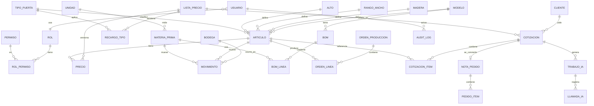

# DATA-MODEL.md — Modelo de datos

PostgreSQL (ADR-0005). Ids `uuid`; fechas `timestamptz` en UTC, mostradas en America/Santiago. Importes en **CLP enteros** (`bigint`). Costos y precios de lista importados del Excel: `numeric(14,4)` (no son importes cotizados). Toda tabla mutable tiene `creado_en`, `creado_por` y `actualizado_en`.

## 1. Diagrama ER

## 2. Tablas

### Usuarios y seguridad (REQ-ADM)
| Tabla | Columnas clave | Reglas |
|---|---|---|
| `permiso` | `codigo` PK (p. ej. `stock.mover`), `descripcion` | Sembrada; lista en SECURITY §1 |
| `rol`, `rol_permiso` | `rol.nombre` único; (`rol_id`, `permiso_codigo`) | Hoy: `administrador` con todos |
| `usuario` | `email` único, `nombre`, `hash_password` (argon2id), `rol_id`, `activo` | No se borra, se desactiva; siempre queda ≥ 1 activo con `usuarios.gestionar` (REQ-ADM-2.4) |
| `sesion` | `token_hash`, `usuario_id`, `expira_en`, `ip` | 8 h |
| `intento_login` | `email`, `ip`, `ocurrido_en`, `ok` | Limitación de intentos |
| `audit_log` | Ver SECURITY §3 | Solo INSERT (trigger) |
| `idempotencia` | `clave` + `usuario_id` PK, `hash_cuerpo`, `respuesta` jsonb, `expira_en` | 24 h |

### Catálogo (REQ-STK-1)
| Tabla | Columnas clave | Reglas |
|---|---|---|
| `modelo` | `nombre` (NELTUME), `codigo` (NEL), `familia` (`puerta`/`accesorio`), `activo` | 33 puertas + 5 accesorios |
| `madera` | `nombre` normalizado (PINO OREGON, LENGA, MARA, RAULI), `codigo` (O/L/M/R) | La comparación ignora tildes |
| `rango_ancho` | `codigo` (1–9), `etiqueta` ("0,80 A 0,85"), `min_m`, `max_m` | Para accesorios: `2x4`…, `6X1`… como texto |
| `alto` | `codigo` (A–G para 2,0–2,6; H… en accesorios), `alto_m` | |
| `tipo_puerta` | `nombre` (BLOQUE, PANEL, ESPECIAL) | |
| `articulo` | `codigo` único (`NEL-R-4-B`), `modelo_id`, `madera_id`, `ancho_codigo` (1–9 en puertas; `2X4`, `6X1`… en accesorios), `ancho_etiqueta`, `alto_codigo`, `alto_m` (alto o largo), `espesor`, `pulgadas`, `tipo_puerta_id` null, `stock_minimo` null, `activo` | Único por (modelo, madera, ancho_codigo, alto_codigo). `rango_ancho` y `alto` quedan como referencia de puertas para el mapeo exacto |
| `bodega` | `nombre` ("Fábrica"), `zona` | Una sola en v1 (supuesto S1) |
| `feriado` | `fecha` PK, `nombre` | Para la vigencia en días hábiles |
| `parametro` | `clave`, `valor` jsonb | `vigencia_dias_habiles`=10, `iva`=0.19, topes de IA |

### Precios versionados (REQ-COT-1)
| Tabla | Columnas clave | Reglas |
|---|---|---|
| `lista_precio` | `version` (serial), `origen` (`excel`/`edicion`), `archivo_hash`, `vigente_desde`, `creado_por`, `vigente` bool | Solo una `vigente`; las antiguas son inmutables |
| `precio` | `lista_id`, `articulo_id`, `costo_produccion`, `costo_materiales`, `costo_insumos`, `costos_generales`, `costo_total`, `margen`, `precio_neto` | PK (`lista_id`, `articulo_id`); costos visibles solo con `costos.ver`; **solo inserción** (trigger) |
| `recargo_tipo` | `lista_id`, `tipo_puerta_id` (null = accesorios), `porcentaje` | Sembrado en 0 % (DESIGN C2) |
| `importacion` | `archivo_hash`, `nombre_archivo`, `lista_id` null, `creadas`, `actualizadas`, `sin_cambios`, `rechazadas`, `rechazos` jsonb `[{fila, motivo}]` | Sin valores de costo ni precio; `GET /importaciones/:id` |

Una edición en pantalla copia la versión vigente, aplica el cambio y crea `version + 1` (REQ-COT-1.1).

### Inventario y producción (REQ-STK, REQ-MP)
| Tabla | Columnas clave | Reglas |
|---|---|---|
| `unidad` | `codigo` (un, m, m2, m3, pulg, kg, lt), `nombre` | |
| `materia_prima` | `nombre` único, `unidad_codigo`, `stock_minimo` null, `activo` | |
| `movimiento` | `ocurrido_en`, `bodega_id`, `articulo_id` XOR `materia_prima_id`, `tipo`, `cantidad` numeric (con signo), `motivo`, `ref_tipo` + `ref_id` (orden, pedido, recepción), `idempotencia_clave`, `usuario_id` | **Inmutable**: un trigger rechaza UPDATE y DELETE; el rol de la app no tiene esos grants |
| `bom` | `modelo_id`, `rango_ancho_id` null, `alto_id` null, `vigente_desde`, `origen` (`real`/`demo`) | Por modelo, opcionalmente por medida (REQ-MP-3.1) |
| `bom_linea` | `bom_id`, `materia_prima_id`, `cantidad` > 0 | |
| `orden_produccion` | `numero`, `estado` (`abierta`/`cerrada`/`anulada`), `nota_pedido_id` null, `cerrada_en` | Cerrar es idempotente (REQ-MP-4.4) |
| `orden_linea` | `orden_id`, `articulo_id`, `cantidad` | |

**Tipos de `movimiento` y su efecto:**

| `tipo` | Existencia | Reservado | Signo de `cantidad` |
|---|---|---|---|
| `entrada_produccion`, `recepcion` | + | | + |
| `salida_despacho`, `consumo_produccion` | − | | − |
| `ajuste` | ± | | ± (motivo obligatorio) |
| `reserva` | | + | + |
| `liberacion` | | − | − (cancelación o despacho) |

Disponible = existencia − reservado. Se calcula con la vista `v_stock` (suma por artículo o materia prima y bodega). Una restricción en la transacción impide que el disponible quede negativo (REQ-STK-4.2, 7.3).

### Comercial (REQ-COT)
| Tabla | Columnas clave | Reglas |
|---|---|---|
| `cliente` | `nombre`, `rut` (único, validado módulo 11), `giro`, `direccion`, `direccion_despacho`, `comuna`, `contacto`, `email`, `telefono`, `tipo` (`tienda`/`directo`) | Datos personales; solo con `clientes.ver` |
| `cotizacion` | `numero` (correlativo, solo para mostrar), `cliente_id` null en borrador, `estado`, `origen` (`ia`/`manual`), `texto_original`, `interpretacion_ia` jsonb, `lista_id`, `subtotal`, `descuento_pct`, `descuento_motivo`, `iva`, `total`, `vigencia_hasta`, `aprobada_por`, `aprobada_en`, `version` | Inmutable desde `aprobada` (trigger) |
| `cotizacion_item` | `cotizacion_id`, `orden`, `articulo_id` null, `descripcion` (generada desde el catálogo; nunca texto de la IA), `cantidad`, `estado_item` (`ok`/`por_confirmar`/`a_pedido`), `duda`, `precio_neto_lista`, `recargo_pct`, `precio_unitario` (entero), `total_linea`, `precio_referencia`, `fijado_por`, `modificado_por`, `modificado_en` | El precio se congela al aprobar |
| `nota_pedido` | `numero`, `cotizacion_id` único, `cliente_id`, `direccion_despacho`, `medio_transporte`, `estado` (`pendiente`/`en_produccion`/`lista`/`despachada`/`cancelada`) | Una por cotización (REQ-COT-8.3) |
| `pedido_item` | `nota_pedido_id`, `articulo_id`, `cantidad`, `reservado`, `faltante`, `precio_unitario`, `total_linea` | Copia congelada |

**Estados de `cotizacion`:** `interpretando → borrador | ia_fallida → aprobada → aceptada | vencida`. `ia_fallida` pasa a borrador manual. `vencida` se calcula cuando `hoy > vigencia_hasta` y el estado es `aprobada`.

### IA (AI.md)
| Tabla | Columnas clave |
|---|---|
| `trabajo_ia` | `cotizacion_id`, `estado` (`pendiente`/`en_curso`/`listo`/`fallido`), `intentos`, `tomado_en`, `error` |
| `llamada_ia` | `trabajo_id`, `modelo`, `entrada_redactada`, `salida` jsonb, `tokens_in`, `tokens_out`, `costo_usd` numeric(10,6), `latencia_ms`, `resultado`, `correlacion_id` |

## 3. Cálculo de una línea (REQ-COT-1.2)

`precio_unitario = round_half_up(precio_neto_lista × (1 + recargo_pct))` · `total_linea = cantidad × precio_unitario` · `subtotal = Σ total_linea` · `descuento = round(subtotal × descuento_pct)` · `neto = subtotal − descuento` · `iva = round(neto × 0,19)` · `total = neto + iva`. El precio con IVA por unidad que se muestra en la lista se calcula con la misma regla.

## 4. Índices y restricciones relevantes

- `articulo(codigo)` es único, y también `articulo(modelo_id, madera_id, rango_ancho_id, alto_id)`.
- `movimiento(articulo_id, bodega_id)`, `movimiento(materia_prima_id, bodega_id)`, y `movimiento(idempotencia_clave)` único cuando no es nulo.
- `cotizacion(estado, creado_en)` y `cotizacion(cliente_id)`. `audit_log(recurso, recurso_id)` y `audit_log(ocurrido_en)`.
- CHECK `articulo_id` XOR `materia_prima_id` en `movimiento`. CHECK de `cantidad` ≠ 0 y signo coherente con `tipo`.

## 5. Importación del Excel (REQ-STK-1.x, REQ-COT-1.1)

Fuente: `datos/COTIZADOR_2026.xlsx` (fuera de git), hojas `Categorias` y `Precio`.

| Paso | Hoja / columnas | Destino | Validación |
|---|---|---|---|
| 1 | `Categorias` C:D (modelos y código) | `modelo` | 38 filas; las 5 últimas son accesorios |
| 2 | `Categorias` G (maderas), R:S (anchos → código), U:V (altos y largos → letra) | `madera`, `rango_ancho`, `alto` | Normaliza "RAULÍ" y "RAULI" (DESIGN C3) |
| 3 | `Precio` fila 4 en adelante: A código, B modelo, C tipo, D ancho, E espesor, F alto, G madera, H pulgadas | `tipo_puerta`, `articulo` | El código recompuesto `MOD-MADERA-ANCHO-ALTO` debe coincidir con A; si no, la fila se rechaza con su motivo |
| 4 | `Precio` I–L costos, M costo total, N margen, O precio neto (P con IVA se ignora y se recalcula) | `lista_precio` + `precio` | Números positivos; O ≈ M × (1 + N) con tolerancia de $1 o se reporta |
| 5 | — | `recargo_tipo` (0 %) | Solo en la primera carga |

- La importación es idempotente: si el hash del archivo ya se importó, no hace nada (REQ-STK-1.3). Si cambia el archivo, crea una nueva `lista_precio` y hace upsert de artículos por código.
- Corre en una transacción. Un fallo de fila no detiene las demás (REQ-STK-1.2), pero un fallo de estructura (falta una hoja o columna) aborta todo.
- Informe: creadas, actualizadas y rechazadas, con fila y motivo, devuelto al usuario. En `audit_log` (`origen=importacion`) se guardan solo conteos, hash del archivo y números de fila rechazados, nunca valores de costo o precio.
- Los fixtures de test usan un Excel reducido y anónimo (`e2e/fixtures/cotizador-mini.xlsx`, unas 50 filas con costos ficticios) con la misma estructura.

## 6. Datos semilla

Rol `administrador` con todos los permisos · primer usuario creado por `npm run crear-admin` (la contraseña se pide por consola y no se guarda en archivos) · bodega "Fábrica" · unidades · parámetros · feriados del año en curso · en demo, BOM de ejemplo (`origen=demo`) para 3 modelos.
