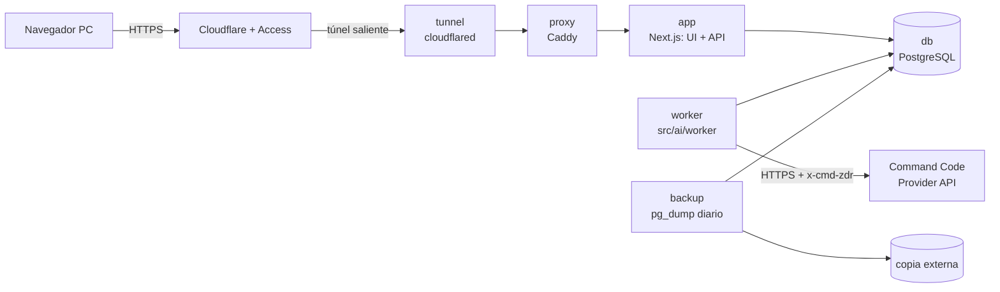
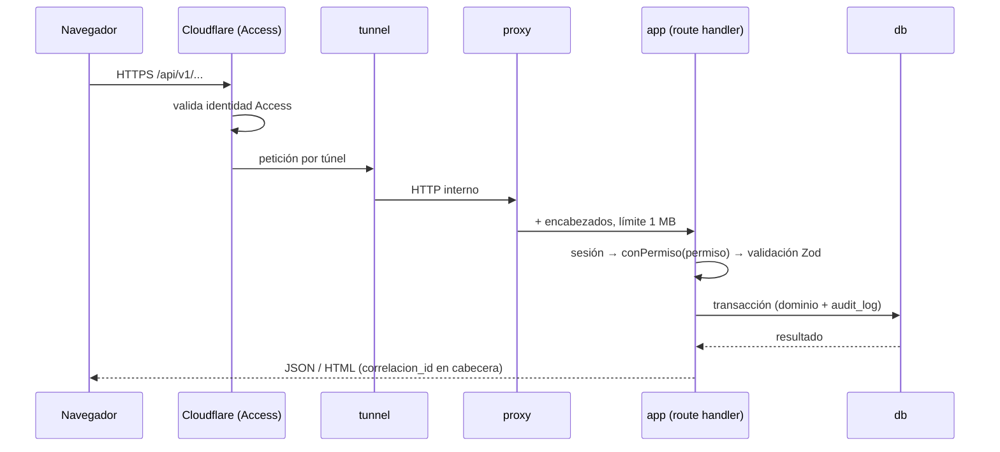

# DESIGN.md — Arquitectura y operación

Cómo se cumple SPEC.md. Seguridad en SECURITY.md, IA en AI.md, datos en DATA-MODEL.md, contratos en API.md y decisiones en docs/adr/.

## 1. Componentes

| Componente | Responsabilidad | Refs |
|---|---|---|
| app | Páginas, route handlers `/api/v1`, dominio (precios, stock, cotizaciones, pedidos, producción), PDF | todas |
| worker | Toma trabajos de interpretación de la cola en BD, llama al LLM vía `src/ai/`, guarda la propuesta | REQ-COT-2.x |
| db | Única fuente de verdad, con triggers de inmutabilidad y la cola de trabajos | REQ-STK-5.3, REQ-ADM-3.3 |
| proxy | Encabezados de seguridad, límite de cuerpo y punto único de entrada desde el túnel | SECURITY §6 |
| tunnel | Conexión saliente a Cloudflare; ningún puerto entrante | REQ-NFR-7 |
| backup | `pg_dump` diario, retención de 30 días local + copia externa | REQ-NFR-4 |

Stack: ADR-0005. Proveedor de IA: ADR-0001. Cola en BD: ADR-0006.

## 2. Flujo de una petición

Cada petición lleva un `correlacion_id` que viaja a logs, `audit_log` y `llamada_ia`.

## 3. Flujo del cotizador

| # | Paso | Dónde | Falla → |
|---|---|---|---|
| 1 | Entrada: el usuario pega el texto (≤ 4.000 caracteres) y elige cliente (opcional) | UI → `POST /api/v1/cotizaciones/interpretaciones` | 400 si está vacío o es demasiado largo; 429 si supera el límite |
| 2 | Normalización: se recortan espacios y se unifican comillas, `x`/`×` y comas decimales | `src/domain/cotizaciones/normalizar.ts` | — |
| 3 | Redacción: se enmascaran RUT, correo, teléfono y URL | `src/ai/redaccion.ts` | — |
| 4 | Encolado: se crea `cotizacion` en borrador, con `texto_original` y un `trabajo_ia` pendiente; la respuesta es 202 con el id | app | — |
| 5 | Extracción estructurada: el worker llama al LLM con el catálogo resumido; la salida es la herramienta `proponer_items` | `src/ai/` (AI.md) | Timeout de 12 s, 2 reintentos solo ante error transitorio; si falla, el borrador queda en `ia_fallida` (paso 10) |
| 6 | Validación del esquema: Zod estricto, sin campos de importe ni descuento | `src/ai/esquema.ts` | Respuesta inválida: 1 reintento y luego `ia_fallida` |
| 7 | Validación contra catálogo: coincidencia exacta de modelo + madera + rango de ancho + alto (o accesorio); si no, `por_confirmar` (o `a_pedido` con precio de referencia del rango o altura superior) | `src/domain/cotizaciones/mapear.ts` | Nunca se completa en silencio |
| 8 | Cálculo determinista: precio de lista neto × (1 + recargo del tipo), redondeado a peso; línea = cantidad × unitario; subtotal, IVA 19 % y total; aviso de stock por ítem | `src/domain/precios/calcular.ts` | — |
| 9 | Borrador listo: la UI hace polling cada 1 s (máx. 30 s) y muestra la revisión lado a lado | UX.md §3 | — |
| 10 | Si la IA falló: aviso y botón "Cotizar a mano" con el texto ya pegado | REQ-COT-2.7 | — |
| 11 | Revisión: el usuario resuelve los `por_confirmar`, fija precios `a_pedido` y aplica descuento con motivo; cada cambio recalcula y se audita | `PATCH .../items/:id` | — |
| 12 | Aprobación: sin ítems por confirmar, congela precios, `aprobada_por/en` y `vigencia_hasta` (+10 días hábiles) | `POST .../aprobar` | 409 si quedan pendientes |
| 13 | PDF: generado en el servidor desde datos congelados; descarga | `GET .../pdf` (ADR-0004) | 409 si no está aprobada |
| 14 | Aceptación del cliente → nota de pedido + reservas (lo disponible; el faltante se marca) | `POST /api/v1/pedidos` | 409 si está vencida o ya tiene pedido |

Días hábiles: lunes a viernes, descontando los feriados de Chile de la tabla `feriado`, que se carga por año.

## 4. Servicios de docker-compose.yml (sin valores)

| Servicio | Imagen / build | Redes | Puertos | Variables (nombres) | Volúmenes |
|---|---|---|---|---|---|
| `tunnel` | `cloudflare/cloudflared` | `borde` | ninguno | `TUNNEL_TOKEN` | — |
| `proxy` | `caddy` | `borde`, `backend` | ninguno | — | `Caddyfile` (ro) |
| `migrar` | build `.` (target `migrar`) | `datos` | ninguno | `DATABASE_ADMIN_URL`, `DATABASE_URL_OWNER`, `DATABASE_URL` | — |
| `app` | build `.` (target `app`) | `backend`, `datos` | ninguno | `DATABASE_URL`, `AUTH_SECRET`, `AUTH_URL`, `APP_TZ=America/Santiago`, `LLM_TOPE_DIARIO_USD`, `LLM_PRESUPUESTO_MENSUAL_USD` (solo para mostrar alertas) | `pdf_tmp` |
| `worker` | build `.` (target `worker`) | `datos`, `salida` | ninguno | `DATABASE_URL`, `CMD_API_KEY`, `CMD_API_BASE_URL`, `CMD_MODEL`, `CMD_ZDR`, `LLM_TIMEOUT_MS`, `LLM_MAX_REINTENTOS`, `LLM_TOPE_DIARIO_USD`, `LLM_PRESUPUESTO_MENSUAL_USD` | — |
| `db` | `postgres:18` (digest al desplegar) | `datos` (internal) | `127.0.0.1:5432` solo con `docker-compose.admin.yml` | `POSTGRES_USER`, `POSTGRES_PASSWORD`, `POSTGRES_DB` | `pg_data` |
| `backup` | `postgres` + cron | `datos` | ninguno | `PGPASSWORD`, `BACKUP_RETENCION_DIAS`, `BACKUP_DESTINO_EXTERNO` | `backups` |

- `datos` y `backend` son `internal: true`. Solo `borde` (tunnel) y `salida` (worker) tienen egreso.
- `app` no tiene la clave del LLM.
- `.env.example` lista estos nombres con una descripción y sin valores.
- Compose es solo de producción. Dev y test usan el PostgreSQL local: `npm run dev` aplica migraciones y semilla y levanta la app; `npm test` recrea las BD de test (TESTING.md §4).

## 5. Errores, cola, reintentos y observabilidad

- **Errores de API.** Formato único `{ "error": { "codigo", "mensaje", "detalles?", "correlacion_id" } }`, con mensajes en español y sin trazas al cliente (API.md §2).
- **Transacciones.**
  - Cada operación de dominio corre en una transacción e incluye su fila de `audit_log`. Si falla la auditoría, falla la operación.
  - La transacción de cierre de producción, conversión a pedido o reserva es todo o nada (REQ-MP-4.1).
- **Idempotencia.**
  - `Idempotency-Key` es obligatoria en los POST de movimientos, recepciones, cierres, pedidos e interpretaciones.
  - Se guarda en `idempotencia` con el hash del cuerpo durante 24 h. Una repetición devuelve la misma respuesta; la misma clave con otro cuerpo da 422.
- **Cola** (`trabajo_ia`, ADR-0006).
  - El worker toma trabajos con `FOR UPDATE SKIP LOCKED`; los estados son `pendiente → en_curso → listo|fallido`.
  - Hay un máximo de 3 intentos. Un trabajo con más de 60 s en `en_curso` se reintenta.
- **Concurrencia.** `cotizacion.version` es un bloqueo optimista; un PATCH con versión vieja da 409.
- **Logs.** JSON a stdout con nivel, `correlacion_id`, ruta, duración y resultado. Se redactan `authorization`, `cookie`, `x-api-key` y los campos de cliente. Rotación con el driver de Docker (10 MB × 5).
- **Métricas mínimas** (`/administracion/metricas` y `GET /api/v1/metricas/ia`, con `auditoria.ver`; últimos 30 días): latencia p50/p90 del cotizador (alta de la cotización → interpretación auditada), costo medio, costo de IA del día y del mes, tasa de `ia_fallida`, trabajos pendientes y llamadas por resultado. Alerta al 80 % del tope diario y del presupuesto mensual (`LLM_PRESUPUESTO_MENSUAL_USD`), visible también en el panel y en los logs del worker.
- **Salud.** `GET /api/v1/salud` (sin sesión, solo `ok` o `degradado`) para healthchecks de Compose.

## 6. Respaldos y restauración

| Qué | Cómo | Frecuencia |
|---|---|---|
| BD completa | `pg_dump -Fc` → volumen `backups` | Diario 02:00 (America/Santiago), retención de 30 días |
| Copia externa | Se sincroniza el último dump a `BACKUP_DESTINO_EXTERNO` (definido en el hosting) | Diario |
| Prueba de restauración | `pg_restore` a una BD temporal, más el chequeo de conteos de `movimiento`, `cotizacion` y `audit_log` | Mensual, documentado en un runbook |

Objetivos: pérdida máxima de 24 h y restauración en menos de 2 h (REQ-NFR-4). El Excel fuente no se respalda aquí: vive en `datos/`, fuera de git.

## 7. Importación del Excel

`scripts/importar-excel.ts` (también accesible desde la UI con `catalogo.editar` y `precios.editar`) lee las hojas `Precio` y `Categorias` de COTIZADOR_2026.xlsx. Mapeo y validaciones en DATA-MODEL.md §5. Es idempotente por hash del archivo y por fila (REQ-STK-1.3).

## 8. Conflictos detectados con AGENTS.md y SPEC.md

| # | Conflicto | Propuesta |
|---|---|---|
| C1 | La línea de stack de AGENTS.md no mencionaba Caddy ni cloudflared | Resuelto: agregados |
| C2 | REQ-COT-1.3 exige recargo por tipo de puerta, pero no hay valores iniciales | Sembrar 0 % por tipo y configurarlos con `config.editar` antes de la demo (memoria: márgenes después) |
| C3 | El Excel trae "RAULI" en `Precio` y "RAULÍ" en `Categorias` | El importador normaliza tildes y mayúsculas al comparar (DATA-MODEL §5) |
| C4 | REQ-NFR-1 pide ≤ 15 s y el worker es asíncrono con polling | El presupuesto de 15 s incluye la cola; con 1 worker y 50–200 cotizaciones/mes no hay espera |
| C5 | AI.md y DATA-MODEL.md agregan `npm run eval:ia` y `npm run crear-admin`, que no están en los comandos de AGENTS.md | Resuelto: agregados a AGENTS.md |
| C6 | SPEC REQ-COT-1.5 habla de ocultar costos a quien no tenga permiso, pero hoy el único rol los ve | Sin conflicto real: aplica cuando haya más perfiles (`costos.ver`) |
