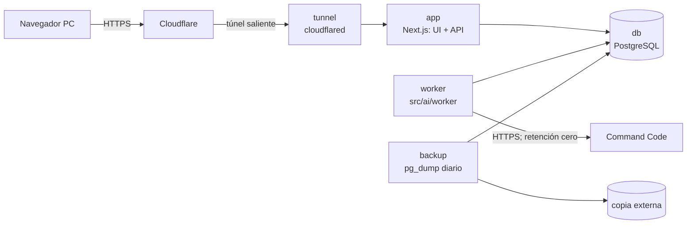
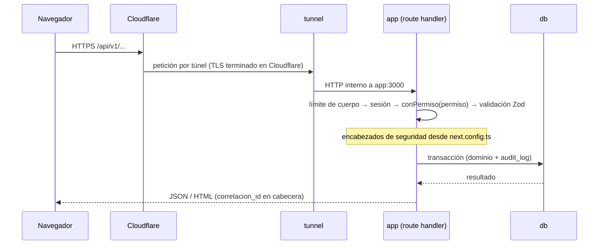

# DESIGN.md — Arquitectura y operación

Cómo se cumple SPEC.md. Seguridad en SECURITY.md, IA en AI.md, datos en DATA-MODEL.md, contratos en API.md y decisiones en docs/adr/.

## 1. Componentes

| Componente | Responsabilidad | Refs |
|---|---|---|
| app | Páginas, route handlers `/api/v1`, dominio (precios, stock, cotizaciones, pedidos, producción), PDF | todas |
| worker | Toma trabajos de interpretación de la cola en BD, llama al LLM vía `src/ai/`, guarda la propuesta | REQ-COT-2.x |
| db | Única fuente de verdad, con triggers de inmutabilidad y la cola de trabajos | REQ-STK-5.3, REQ-ADM-3.3 |
| tunnel | Conexión saliente a Cloudflare; ningún puerto entrante; único camino de internet a la app (sin Access ni proxy intermedio: ADR-0010, ADR-0011) | REQ-NFR-7 |
| backup | `pg_dump` diario, retención de 30 días local + copia externa | REQ-NFR-4 |

Stack: ADR-0005. Proveedor de IA: ADR-0001. Cola en BD: ADR-0006.

## 2. Flujo de una petición

Cada petición lleva un `correlacion_id` que viaja a logs, `audit_log` y `llamada_ia`.

## 3. Flujo del cotizador

| # | Paso | Dónde | Falla → |
|---|---|---|---|
| 1 | Entrada: el usuario pega el texto (≤ 4.000 caracteres) y elige cliente (opcional) | UI → `POST /api/v1/cotizaciones/interpretaciones` | 400 si está vacío o es demasiado largo; 429 si supera el límite |
| 2 | Normalización: se recortan espacios y se unifican comillas, `x`/`×` y comas decimales | `src/domain/cotizaciones/normalizar.ts` | — |
| 3 | Redacción: se enmascaran RUT, correo, teléfono y URL | `src/ai/redaccion.ts` | — |
| 4 | Encolado: se crea `cotizacion` en borrador, con `texto_original` y un `trabajo_ia` pendiente; la respuesta es 202 con el id | app | — |
| 5 | Extracción estructurada: el worker llama al LLM con el catálogo resumido; la salida es la herramienta `proponer_items` | `src/ai/` (AI.md) | Timeout de 12 s, 2 reintentos solo ante error transitorio; si falla, el borrador queda en `ia_fallida` (paso 10) |
| 6 | Validación del esquema: Zod estricto, sin campos de importe ni descuento | `src/ai/esquema.ts` | Respuesta inválida: 1 reintento y luego `ia_fallida` |
| 6a | Cobertura del pedido: una segunda lectura busca fragmentos omitidos; si sigue faltando una cantidad por destino sin producto explícito, se conserva como ítem desconocido `por_confirmar`, con alerta y sin precio | `src/domain/cotizaciones/anclaje.ts`, `src/ai/revision.ts` · REQ-COT-2.14/2.15 · ADR-0014 | La interpretación cruda se conserva; no se asigna modelo ni madera |
| 7 | Validación contra catálogo: coincidencia exacta de modelo (o alias seguro) + madera + rango de ancho + alto, o de accesorio + madera + escuadría/sección + largo, con la medida en m, cm o mm; si no, `por_confirmar` (o `a_pedido` con precio de referencia del rango o altura superior) | `src/domain/cotizaciones/mapear.ts` | Nunca se completa en silencio |
| 8 | Cálculo determinista: precio de lista neto × (1 + recargo del tipo), redondeado a peso; línea = cantidad × unitario; subtotal, IVA 19 % y total; aviso de stock por ítem | `src/domain/precios/calcular.ts` | — |
| 9 | Borrador listo: la UI hace polling cada 1 s (máx. 30 s) y muestra la revisión lado a lado | UX.md §3 | — |
| 9a | Sugerencias sin IA, calculadas al leer y sin guardarse: cliente por RUT/correo/teléfono del texto original (patrones del enmascarado), cotizaciones posiblemente repetidas y plazo pedido | `src/domain/cotizaciones/pistas.ts`, `plazo.ts` · REQ-COT-2.18–2.20 | Ninguna se aplica sola; aceptar el cliente es un PATCH auditado con `clienteDetectadoPor` |
| 10 | Si la IA falló: aviso y botón "Cotizar a mano" con el texto ya pegado | REQ-COT-2.7 | — |
| 11 | Revisión: el usuario resuelve los `por_confirmar`, fija precios `a_pedido` y aplica descuento con motivo; cada cambio recalcula y se audita | `PATCH .../items/:id` | — |
| 12 | Aprobación: sin ítems por confirmar, congela precios, `aprobada_por/en` y `vigencia_hasta` (+10 días hábiles) | `POST .../aprobar` | 409 si quedan pendientes |
| 13 | PDF: generado en el servidor desde datos congelados; descarga | `GET .../pdf` (ADR-0004) | 409 si no está aprobada |
| 14 | Aceptación del cliente → nota de pedido + reservas (lo disponible; el faltante se marca) | `POST /api/v1/pedidos` | 409 si está vencida o ya tiene pedido |

Días hábiles: lunes a viernes, descontando los feriados legales de Chile (calculados por ley para cualquier año, `src/domain/precios/feriados.ts`) y los adicionales de la tabla `feriado` (REQ-COT-6.6).

## 4. Servicios de docker-compose.yml (sin valores)

| Servicio | Imagen / build | Redes | Puertos | Variables (nombres) | Volúmenes |
|---|---|---|---|---|---|
| `tunnel` | `cloudflare/cloudflared` | `borde`, `backend` | ninguno | `TUNNEL_TOKEN` | — |
| `migrar` | build `.` (target `migrar`) | `datos` | ninguno | `DATABASE_ADMIN_URL`, `DATABASE_URL_OWNER`, `DATABASE_URL` | — |
| `app` | build `.` (target `app`) | `backend`, `datos` | ninguno | `DATABASE_URL`, `APP_URL`, `APP_TZ`, topes de gasto | — |
| `worker` | build `.` (target `worker`) | `datos`, `salida` | ninguno | `DATABASE_URL`, `CMD_API_KEY`, URL opcional, timeout, reintentos y topes | — |
| `db` | `postgres:18` fijada por digest (como todas las imágenes y la base del Dockerfile) | `datos` (internal) | `127.0.0.1:5432` solo con `docker-compose.admin.yml` | `POSTGRES_USER`, `POSTGRES_PASSWORD`, `POSTGRES_DB` | `pg_data` |
| `backup` | `postgres` + cron | `datos` | ninguno | `PGPASSWORD`, `BACKUP_RETENCION_DIAS`, `BACKUP_DESTINO_EXTERNO` | `backups` |

| `compras` (ADR-0021; perfil `chipax`) | build `.` (target `compras`) | `datos`, `salida` | ninguno | `DATABASE_URL_COMPRAS` (rol `neltume_compras`), `CHIPAX_APP_ID`, `CHIPAX_SECRET_KEY` | — |

- `datos` y `backend` son `internal: true`. Solo `borde` (tunnel) y `salida` (worker y compras) tienen egreso.
- Las API keys de proveedor solo se inyectan en `worker`; `app` y el navegador no las reciben.
- `.env.example` lista estos nombres con una descripción y sin valores.
- Compose es solo de producción. Dev y test usan el PostgreSQL local: `npm run dev` aplica migraciones y semilla y levanta la app; `npm test` recrea las BD de test (TESTING.md §4).

## 5. Errores, cola, reintentos y observabilidad

- **Errores de API.** Formato único `{ "error": { "codigo", "mensaje", "detalles?", "correlacion_id" } }`, con mensajes en español y sin trazas al cliente (API.md §2).
- **Transacciones.**
  - Cada operación de dominio corre en una transacción e incluye su fila de `audit_log`. Si falla la auditoría, falla la operación.
  - La transacción de cierre de producción, conversión a pedido o reserva es todo o nada (REQ-MP-4.1).
- **Idempotencia.**
  - `Idempotency-Key` es obligatoria en los POST de movimientos, recepciones, cierres, pedidos e interpretaciones.
  - Antes de ejecutar se **reserva** la clave en `idempotencia` (estado «en curso», con el hash de método + ruta + cuerpo) y se guarda la respuesta al terminar, durante 24 h. Una repetición devuelve la misma respuesta; mientras la primera sigue en curso, 409 `IDEMPOTENCIA_EN_CURSO`; la misma clave con otro cuerpo u otra ruta da 422. Si la acción falla (excepción o 5xx) se libera la clave para reintentar. Una reserva en curso de más de 2 min se da por abandonada (riesgo residual: una caída entre el commit de la acción y el guardado de la respuesta permite repetirla).
  - El navegador usa una clave por envío y reintenta con esa misma clave ante un corte de red o un 409 en curso (`src/lib/api-cliente.ts`); si no logra confirmar, avisa «No pudimos confirmar si se guardó», nunca «no se guardó».
- **Cola** (`trabajo_ia`, ADR-0006).
  - El worker toma trabajos con `FOR UPDATE SKIP LOCKED`; los estados son `pendiente → en_curso → listo|fallido`.
  - Hay un máximo de 3 intentos. Un trabajo con más de `IA_TRABAJO_COLGADO_S` (180 s por defecto, más que el peor caso de reintentos y segunda pasada) en `en_curso` vuelve a la cola; si ya agotó sus intentos, queda `fallido` y la cotización `ia_fallida`.
  - Solo escribe el resultado el intento dueño del trabajo (mismo número de intento, aún `en_curso`) y si la cotización sigue `interpretando`; un resultado tardío se descarta (auditoría H-09).
  - El worker usa su propio rol de BD con permisos mínimos (ADR-0017).
- **Concurrencia.** `cotizacion.version` es un bloqueo optimista; un PATCH con versión vieja da 409.
- **Logs.** JSON a stdout con nivel, `correlacion_id`, ruta, duración y resultado. Se redactan `authorization`, `cookie`, `x-api-key` y los campos de cliente. Rotación con el driver de Docker (10 MB × 5).
- **Métricas mínimas** (`/administracion/metricas` y `GET /api/v1/metricas/ia`, con `auditoria.ver`; últimos 30 días): latencia p50/p90 del cotizador (alta de la cotización → interpretación auditada), costo medio, costo de IA del día y del mes, tasa de `ia_fallida`, trabajos pendientes y llamadas por resultado. Alerta al 80 % del tope diario y del presupuesto mensual (`LLM_PRESUPUESTO_MENSUAL_USD`), visible también en el panel y en los logs del worker.
- **Salud.** `GET /api/v1/salud` (sin sesión, solo `ok` o `degradado`) para healthchecks de Compose.

## 6. Respaldos y restauración

| Qué | Cómo | Frecuencia |
|---|---|---|
| BD completa | `pg_dump -Fc` → volumen `backups`, con `.sha256` y `.conteos` (filas de `movimiento`, `cotizacion` y `audit_log` al respaldar) | Diario 02:00 (America/Santiago), retención de 30 días |
| Copia externa | Se copia cada respaldo a `BACKUP_DESTINO_EXTERNO` (ruta del host montada en `/externo`) y se verifica su checksum; si no está montado, el log lo marca como error | Diario |
| Prueba de restauración | `scripts/restaurar-prueba.sh`: checksum, `pg_restore` a una BD temporal, conteos ≥ los del respaldo y tiempo medido (RUNBOOK §4) | Mensual |

Objetivos: pérdida máxima de 24 h y restauración en menos de 2 h (REQ-NFR-4). El Excel fuente no se respalda aquí: vive en `datos/`, fuera de git.

## 7. Importación del Excel

`scripts/importar-excel.ts` (también accesible desde la UI con `catalogo.editar` y `precios.editar`) lee las hojas `Precio` y `Categorias` de `datos/Cotizador Puertas Neltume.Co-rev-4E.xlsx` (fuente de verdad). Mapeo y validaciones en DATA-MODEL.md §5. Es idempotente por hash del archivo y por fila (REQ-STK-1.3).

## 8. Conflictos detectados con AGENTS.md y SPEC.md

| # | Conflicto | Propuesta |
|---|---|---|
| C1 | La línea de stack de AGENTS.md no mencionaba Caddy ni cloudflared | Resuelto: agregados |
| C2 | REQ-COT-1.3 exige recargo por tipo de puerta, pero no hay valores iniciales | Sembrar 0 % por tipo y configurarlos con `config.editar` antes de la demo (memoria: márgenes después) |
| C3 | El Excel trae "RAULI" en `Precio` y "RAULÍ" en `Categorias` | El importador normaliza tildes y mayúsculas al comparar (DATA-MODEL §5) |
| C4 | REQ-NFR-1 pide ≤ 15 s y el worker es asíncrono con polling | El presupuesto de 15 s incluye la cola; con 1 worker y 50–200 cotizaciones/mes no hay espera |
| C5 | AI.md y DATA-MODEL.md agregan `npm run eval:ia` y `npm run crear-admin`, que no están en los comandos de AGENTS.md | Resuelto: agregados a AGENTS.md |
| C6 | SPEC REQ-COT-1.5 habla de ocultar costos a quien no tenga permiso, pero hoy el único rol los ve | Sin conflicto real: aplica cuando haya más perfiles (`costos.ver`) |

## 9. Ajustes de IA (REQ-ADM-4.x, ADR-0009, ADR-0022)

`/administracion/ia` y `GET/PUT /api/v1/ajustes/ia` requieren `config.editar`. El worker consulta Command Code con la clave del entorno (`CMD_API_KEY`) y cachea modelos, compatibilidad y precios públicos en `parametro`; la UI solo lee la caché. En desarrollo la clave vive en `.env.worker.local`; en producción solo se inyecta en `worker`. Los catálogos llevan fecha y una falla externa conserva la última copia válida.

Ajustes guarda proveedor y modelo; no recibe ni persiste API keys. GET, respuestas, logs y auditoría nunca incluyen secretos. Cada trabajo captura proveedor/modelo al tomarlo y el worker usa la clave de entorno; cambiar el modelo rige desde el siguiente trabajo. Command Code usa Chat Completions con `x-cmd-zdr: 1` y herramienta forzada. Groq se retiró (ADR-0022): una configuración guardada con Groq se lee como «sin proveedor». Preview y modelos sin chat/herramienta no se activan. La evaluación queda disponible como referencia, sin bloquear la selección inmediata.

**Modo de razonamiento (REQ-COT-2.17, ADR-0015):** `src/ai/razonamiento.ts` resuelve el control de esfuerzo antes de llamar al LLM. En Command Code, GPT-6 Luna usa `low`. Cuando un proveedor no admite un control comprobado, se omite el parámetro y se conserva la compatibilidad normal del catálogo; Qwen 3.7 Flash sigue seleccionable. Ajustes muestra el modo efectivo. El worker y `npm run eval:ia` aplican la misma política; la evaluación real sigue siendo informativa.

## 10. Compras desde Chipax (ADR-0021)

`src/compras/` es el único módulo que habla con Chipax: `chipax.ts` (login, `/compras` paginado con espera por el límite y `Retry-After`, descarga del XML solo desde `https` y `*.chipax.com`), `dte.ts` (parser con `saxes`, sin DTD), `corrida.ts` y `servicio.ts` (bucle que sondea cada 15 s). La decisión de cada línea es pura (`src/domain/compras/mapeo.ts`) y la usan la corrida y «Asociar y recibir» (`src/domain/compras/lineas.ts`). La corrida hace esto, en orden:

1. Toma la petición pendiente de `sincronizacion_chipax` o espera el intervalo.
2. Lista las compras de la ventana (sin `conXml`, que en la API real devuelve 0; la API responde en camelCase).
3. Filtra por RUT habilitado y fecha de habilitación.
4. Inserta cada compra y sus líneas, una transacción por factura.
5. Recibe las líneas con mapeo exacto con `registrarRecepcion` y la clave de idempotencia de la línea.
6. Deja el resto por asociar o por revisar.

Si una factura falla (XML aún no disponible, `410`, error de formato), se registra en los conteos y se reintenta en la corrida siguiente. Las demás facturas siguen. En `npm test` el cliente apunta a un Chipax simulado local (como el Command Code simulado de E2E 17).

## 11. Recepción de las notas de la tienda (ADR-0023)

`src/domain/integracion-tienda/` es el único módulo que recibe datos de la tienda. Las rutas están en `src/app/api/integrations/neltume/` y van envueltas en `integracion()` (`src/domain/auth/integracion.ts`). Una petición pasa por este orden:

1. Acota el cuerpo (20 MB pedidos, 10 MB adjuntos) y revisa el `Content-Type`.
2. Lee la configuración (`firma.ts`; sin secreto, 503) y verifica la firma HMAC sobre los bytes crudos.
3. Parsea con el esquema estricto (`contrato.ts`, réplica del de la tienda) y comprueba clave de idempotencia y destino.
4. Si la clave y el cuerpo ya se recibieron, responde `duplicate` sin volver a leer los PDF.
5. Verifica los PDF (`documentos.ts`): base64, sha256, `%PDF-`, `pdfjs-dist`, número de la nota y montos en el de producción.
6. Abre **una** transacción (`recibir.ts`): candado por pedido de la tienda, idempotencia y revisión, nota vigente (`nota.ts`), alta o reemplazo con `insertarPedido`, documentos y auditoría.

Las líneas se arman en `lineas.ts` (lista vigente sin recargo; código desconocido o especial «a pedido, revisar»). Una persona resuelve lo pendiente con `resolver.ts`. La ficha lee `consulta.ts`, y la orden de trabajo sale de `src/domain/pdf/orden-trabajo.tsx`. Lo comercial nunca entra en precios ni totales (SECURITY T2).
